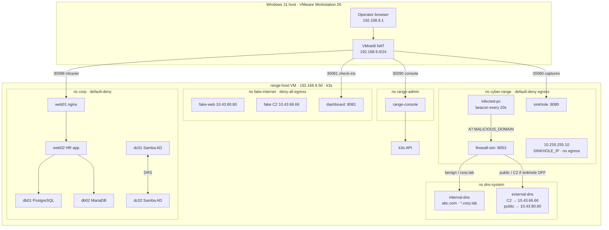

# PurpleRange — Isolated Cyber Range Deployment Kit

A repeatable, fully-isolated purple-team cyber range for VMware Workstation
(portable to vSphere/Proxmox). Runs the same infected-endpoint scenario **with**
and **without** a DNS sinkhole so SOC trainees can contrast containment and
visibility. **All traffic is synthetic and benign — no real malware, no real
C2, no real internet.**

> **Do not host this on Tails OS.** Tails is amnesic/RAM-only and Tor-routed —
> it cannot host persistent nested VMs and violates the "no real internet"
> rule. Host on VMware Workstation on a normal machine.

> **Do not mix labs on this PC.** `ODS-Ubuntu` is the CSI Nora / local-LLM box.
> `range-host` is the only place the cyber range should run (nested KVM).
> Tails is an unrelated privacy guest. Do not install CSI Nora on range-host,
> and do not put range VMs on ODS-Ubuntu or Tails.

## Host requirements
- VMware Workstation (provides `vmrun.exe` + `vnetlib64.exe`)
- This laptop uses a **trimmed** 5-VM inventory (~7 GB guests). Full 14-VM design
  is in `ubuntu/inventory/vms.full.tsv` and the `Enabled=$false` rows in
  `config/inventory.psd1`. Give `range-host` 8–12 GB before deploying.
- Base VM templates under `C:\CyberRange\Templates\<template>\<template>.vmx`
  (pfSense, Security Onion, Windows Server 2022, Windows 10, Debian 12,
  Ubuntu 22, Kali) — you supply these golden images and their licensing.

## Layout
```
cyber-range/
  config/      inventory.psd1 (source of truth) + DNS/firewall configs
  deploy/      00-preflight  01-create-networks  02-deploy-vms  03-boot-order  99-teardown
  k8s/         in-cluster range (images, manifests, scripts) — this is what runs today
  scenario/    scenario-toggle.ps1  benign-beacon.ps1
  validate/    validate.ps1
  ansible/     inventory.ini  site.yml  (guest configuration)
  docs/        playable architecture + data/log-flow animation (GitHub Pages)
```

The live range is a single k3s node on **range-host** (`192.168.9.50` on VMnet8 NAT).
The full VM inventory is trimmed; `SVC-DC` and `EXT-INETSIM` are replaced by the
in-cluster `corp` and `fake-internet` namespaces. See [k8s/README.md](k8s/README.md)
for deploy steps.

**Playable animation (play / pause / step, four scenarios):**
https://2017ht66087.github.io/cyber-range-dns-sinkhole/
(also [`docs/index.html`](docs/index.html) if you want to open it offline).

## Architecture

Windows 11 host → VMware Workstation → **range-host** (k3s). Five namespaces:

| Namespace | Workloads | Role |
|---|---|---|
| `cyber-range` | infected-pc, firewall-sim, sinkhole | Beacon, DNS policy, capture |
| `dns-system` | internal-dns, external-dns | Lab + fake-public resolvers |
| `fake-internet` | fake-web, fake C2, dashboard | INetSim-style web + inert C2 |
| `corp` | dc01/dc02, db01/db02, web01/web02 | Thin AD + 3-tier intranet |
| `range-admin` | range-console | Login, scenarios, logs |



**Addresses (lab-only):** sinkhole `10.255.255.10`, fake C2 `10.43.66.66`,
fake web `10.43.80.80`, corp Services `10.43.200.11–32`. Nothing routes to the
real internet.

### Endpoints on range-host

| Service | URL / port | What it shows |
|---|---|---|
| Range console | http://192.168.9.50:30090/ | Login, scenarios, logs, captures, check-ins |
| Sinkhole dashboard | http://192.168.9.50:30080/ | JSON: `/api/captures` |
| Fake internet | http://192.168.9.50:30081/ | JSON: `/api/checkins`, `/api/requests` |
| Corp intranet | http://192.168.9.50:30088/ | `/app/` → web02 HR portal (VMnet8 only) |
| firewall-sim DNS | `192.168.9.50:30053` | Policy resolver infected-pc uses |
| internal-dns | `192.168.9.50:30054` | `abc.com` + `*.corp.lab` |
| external-dns | `192.168.9.50:30055` | Simulated public resolver |

## Data and log flow

Behaviour is driven by ConfigMap `range-mode` in `cyber-range` and `dns-system`
(`SINKHOLE_ENABLED`, `MALICIOUS_DOMAIN`, …). Launching a scenario from the
console PATCHes those ConfigMaps and restarts firewall-sim, infected-pc, and
the DNS deployments. `corp-lateral.yaml` is **off** unless you apply it by hand.

### Sinkhole ON (contained) — live default

1. **Beacon query.** infected-pc sends `A? teq.xyz.com` to firewall-sim `:8053`.
2. **Intercept + capture.** firewall-sim answers `10.255.255.10` and POSTs a
   `dns-intercept` record to sinkhole `:8080/capture`.
3. **Callback blocked.** infected-pc POSTs `/checkin` to `10.255.255.10:80`.
   default-deny-egress has no rule for that address, so the packet never leaves
   the pod. Log: `[CONTAINED] teq.xyz.com -> 10.255.255.10`.
4. **Benign browse.** Each cycle also looks up `www.example.com`. firewall-sim
   forwards to external-dns → fake-web `10.43.80.80`. GET `/` is logged; nothing
   reaches the real internet.

```
infected-pc --DNS--> firewall-sim --answer 10.255.255.10--> infected-pc
                         |
                         +--POST /capture--> sinkhole --/api/captures--> console :30090
                                                            \--> dashboard :30080
infected-pc --POST /checkin--> 10.255.255.10   [DENIED by NetworkPolicy]
infected-pc --GET /--> fake-web --log--> fake-internet dashboard :30081
```

**Evidence:** pod stdout (`kubectl logs` / console Logs tab), sinkhole captures
on `:30080`, fake-web requests on `:30081`. Fake C2 `/api/checkins` stays empty.

### Sinkhole OFF (uncontained)

1. Console (or `./toggle-variant.sh without`) sets `SINKHOLE_ENABLED=false` and
   rolls the deployments.
2. The same beacon is **forwarded** to external-dns.
3. external-dns answers the fake C2 ClusterIP `10.43.66.66`.
4. infected-pc POSTs `/checkin` to that address (allow-infected-to-fake-internet).
   Fake C2 returns an inert `sleep` task. Log: `[UNCONTAINED] … REACHED fake C2`.
5. Check-ins appear on `:30081` and in the console. fake-internet has
   deny-all-egress, so nothing leaves the cluster. The sinkhole gets no new captures.

```
infected-pc --DNS--> firewall-sim --forward--> external-dns --10.43.66.66--> infected-pc
infected-pc --POST /checkin--> fake C2 --task sleep--> infected-pc
                                   \--> dashboard :30081 --/api/checkins--> console
```

### Corp 3-tier + AD (always on)

Browser `:30088` → web01 (nginx) → web02 → db01 (`hr.employees`) and db02
(`customers`). dc01 ↔ dc02 DRS replication is independent of the sinkhole mode.

### Lateral movement (opt-in, off)

`kubectl apply -f k8s/manifests/corp-lateral.yaml` opens a narrow path from
infected-pc into corp (LDAP/Kerberos/SMB, both DBs, HTTP). The off-cluster
callback stays denied, so a sinkhole-ON beacon is still contained. The console
cannot apply this policy (its RBAC is read-only in `corp`).

### Where logs land

| Source | Path | Viewer |
|---|---|---|
| infected-pc / firewall-sim / DNS stdout | k3s `pods/log` | Console Logs tab |
| Sinkhole captures | `sinkhole:8080/api/captures` | `:30080` and console |
| Fake C2 check-ins + web requests | `fake-internet:8081/api/*` | `:30081` and console |
| Scenario launch | console → k3s API PATCH ConfigMap + rollout | Console Overview |

## Quick start (elevated PowerShell on the VMware host)
```powershell
cd cyber-range\deploy
.\00-preflight.ps1                              # verify tooling/resources/templates
.\01-create-networks.ps1 -DryRun                # review VMnet commands, then run for real
.\01-create-networks.ps1
.\02-deploy-vms.ps1 -Linked                     # clone all VMs + baseline-clean snapshot
# configure guests from MGMT-ORCH:  ansible-playbook -i ansible/inventory.ini ansible/site.yml
# then snapshot 'scenario-armed' on each VM
.\03-boot-order.ps1 -Action Start -RevertTo scenario-armed
```

## Run an exercise
```powershell
# Path A — sinkhole ON (contained)
..\scenario\scenario-toggle.ps1 -Path A
#   on EP-INFECTED:  ipconfig /renew ; .\benign-beacon.ps1
..\validate\validate.ps1 -Path A

# Path B — sinkhole OFF (beacon reaches attacker)
..\scenario\scenario-toggle.ps1 -Path B
#   on EP-INFECTED:  ipconfig /renew ; .\benign-beacon.ps1
..\validate\validate.ps1 -Path B
```

## Reset / cleanup
```powershell
.\99-teardown.ps1 -Mode Reset      # revert all to scenario-armed (fast)
.\99-teardown.ps1 -Mode Clean      # revert all to baseline-clean
.\99-teardown.ps1 -Mode Destroy -Confirm   # delete all clones (export evidence first)
```

## Safety notes
- No VM has a bridged/NAT adapter — VMnets are host-only; attacker/external/
  users/servers segments have **no host adapter** (blind).
- `benign-beacon.ps1` only emits a DNS query + an HTTP POST of the EICAR test
  string. It does not download, persist, or self-replicate.
- Every `*.ps1` supports `-DryRun` (or shows exact commands) so you can review
  before anything executes. `vnetlib64` syntax varies by Workstation version —
  always `-DryRun` `01-create-networks.ps1` first.
